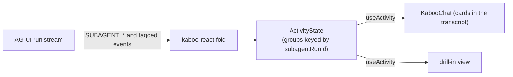

# Concepts — the data model

How kaboo-react turns an AG-UI stream into the chat, the agent cards and the
canvas you see.

## One stream

Everything rides the **same AG-UI run stream** as the chat — there is no second
endpoint. The entry agent's text and tool calls are the chat. Each agent it
delegates to arrives as AG-UI's own sub-agent events: `SUBAGENT_STARTED`, its
text, reasoning and tool events tagged with its `subagentRunId`, and
`SUBAGENT_FINISHED`. kaboo-react folds those into a tree of `StreamGroup`s that
the chat, the agent cards and the drill-in view all read from. The same fold
runs live and on replay, so a reload draws the same cards.



## `StreamGroup` — one sub-agent invocation

Each invocation is a `StreamGroup`, keyed by its `subagentRunId`. The tree is
formed by `parentGroup` (a group id or `null` for a top-level group), and each
top-level group sits in the transcript at the call that started it
(`toolCallId`). The fields you'll touch most:

| Field | Meaning |
|-------|---------|
| `title` / `agentName` | Display title and machine name of the agent. |
| `parentGroup` | Parent group id, or `null` for a top-level group. |
| `toolCallId` | The delegating call the card sits at. |
| `status` | `active` \| `completed` \| `interrupted` \| `error` \| `stopped`. |
| `task` | What this agent was asked to do (shown atop its card). |
| `timeline` | Interleaved text and tool entries, in order. |
| `tools` | Every tool call in the group, in call order, with `toolLabel` when the workflow names it. |
| `structuredOutput` / `outputSchemaName` | Schema-shaped output, and which renderer draws it. |
| `usage` | The agent's token usage. |
| `runIds` | Every run that streamed into the group: a paused agent resumes in a new run. |
| `traceId` | The agent's trace, for feedback scores. |

`ActivityState` also holds `usageByRun` and `traceByRun`, from each run's
`RUN_FINISHED`.

## What the transcript shows

- **A delegate is a card** at the call that started it, not a tool row. Its own
  tool calls render inside it, with the same renderers as the chat.
- **What needs the person is lifted into the transcript.** A delegate's
  question, request or approval shows in the main chat, labelled with the agent,
  while it waits; once answered it stays in the agent's card.
- **Tool calls render as they stream.** Arguments arrive as the model writes
  them, so a renderer can draw a query or a widget before the call runs
  ([Custom tool cards](tool-cards.md)).
- **A failed run says why.** A notice with the run's error follows its last
  message, or the question when the run said nothing, live and on replay.
- **A streaming run re-renders at most every 50 ms** (`throttleMs` on
  `KabooProvider`), and a long thread renders only the rows in view.

## Reading the tree

`useActivity()` returns the groups; helpers navigate them:

```tsx
import { useActivity, topLevelGroups, directChildren } from "@pgege/kaboo-react";

export function RootCount() {
  const { groups } = useActivity();
  const roots = topLevelGroups(groups);
  return <span>{roots.length} root agents</span>;
}
```

See [Activity panel & drill-down](activity-panel.md) for the components that
render this tree, and [Human-in-the-loop](hitl.md) for questions and approvals.

## Shared state and the canvas

The agents' shared state arrives as `STATE_SNAPSHOT` and `STATE_DELTA` events.
Three hooks let a canvas follow the agent:

| Hook | Returns |
|------|---------|
| `useAgentState(select)` | A slice of the shared state, read again whenever the state changes. |
| `useLiveToolCalls(match)` | The calls in flight whose tool name matches, with their arguments so far — for ghost widgets while a plot call streams. |
| `useAgentPresence()` | Which sub-agents are working now, and on which tool. |

```tsx
import { useAgentPresence, useAgentState, useLiveToolCalls } from "@pgege/kaboo-react";

export function CanvasStatus() {
  const dashboards = useAgentState((state) => Object.keys((state.kaboo_workspace as { dashboards?: object })?.dashboards ?? {}));
  const plotting = useLiveToolCalls(/___plot_widgets$/);
  const working = useAgentPresence();
  return (
    <p>
      {dashboards.length} dashboards · {plotting.length} plotting · {working.map((agent) => agent.title).join(", ")}
    </p>
  );
}
```

## Where it sits in the stack

kaboo-react is the UI layer of the
[kaboo stack](https://gl-pgege.github.io/kaboo-docs/):
[kaboo-workflows](https://gl-pgege.github.io/kaboo-workflows/) produces the
stream, [kaboo-runtime](https://gl-pgege.github.io/kaboo-runtime/) persists and
replays it, and kaboo-react renders it.
